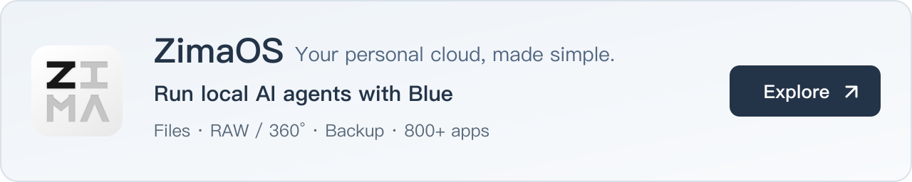

# ZimaOS Blue v0.11.0

More reliable skill discovery, document workflows, and task completion.

## Downloads

| Platform | Package | Download size |
| --- | --- | ---: |
| macOS desktop · Apple Silicon | [ZimaOS-Blue-0.11.0-macos-arm64.dmg](https://github.com/IceWhaleTech/ZimaOS-Blue/releases/download/0.11.0/ZimaOS-Blue-0.11.0-macos-arm64.dmg) | 31.94 MiB |
| macOS desktop · Intel | [ZimaOS-Blue-0.11.0-macos-amd64.dmg](https://github.com/IceWhaleTech/ZimaOS-Blue/releases/download/0.11.0/ZimaOS-Blue-0.11.0-macos-amd64.dmg) | 35.01 MiB |
| macOS CLI · Apple Silicon | [blue-0.11.0-darwin-arm64.tar.gz](https://github.com/IceWhaleTech/ZimaOS-Blue/releases/download/0.11.0/blue-0.11.0-darwin-arm64.tar.gz) | 31.22 MiB |
| macOS CLI · Intel | [blue-0.11.0-darwin-amd64.tar.gz](https://github.com/IceWhaleTech/ZimaOS-Blue/releases/download/0.11.0/blue-0.11.0-darwin-amd64.tar.gz) | 33.56 MiB |
| Linux · x86_64 | [blue-0.11.0-linux-amd64.tar.gz](https://github.com/IceWhaleTech/ZimaOS-Blue/releases/download/0.11.0/blue-0.11.0-linux-amd64.tar.gz) | 46.52 MiB |
| Linux · arm64 | [blue-0.11.0-linux-arm64.tar.gz](https://github.com/IceWhaleTech/ZimaOS-Blue/releases/download/0.11.0/blue-0.11.0-linux-arm64.tar.gz) | 44.28 MiB |
| ZimaOS module | [zimaos-blue.raw](https://github.com/IceWhaleTech/ZimaOS-Blue/releases/download/0.11.0/zimaos-blue.raw) | 46.66 MiB |

## Improved

- Automatically select installed document skills such as FiLens for relevant tasks, including spreadsheet and cross-file calculations.
- Preserve shell evidence needed for follow-up reasoning and report request token usage through skill search and advice APIs.
- Check requested outcomes before finishing and stop once the requested results have been delivered.
- Rewrite conversational skill searches into useful search terms, with cached multilingual query planning and fallback when rewriting is unavailable.
- Reuse Photos' local language detection with a 938,013-byte model; no translation runtime or language packs are bundled.

## Fixed

- Correct macOS PDF form inspection and filling by using PDFKit's actual annotation keys and field type names.
- Refresh frontend dependencies to address the vulnerabilities reported by the release dependency audit.

## Packaging

- Align CLI, web, Rust, and desktop metadata at 0.11.0.
- Build macOS CLI and desktop packages for Apple Silicon and Intel, verify their architectures and signatures, require accepted Apple notarization, and validate the DMG's stapled ticket.
- Fail release preparation early when required signing credentials are unavailable. Manual validation builds do not publish release assets.

[Release validation build](https://github.com/IceWhaleTech/ZimaOS-Blue/actions/runs/45145923323) passed for both macOS architectures, including Developer ID signing, accepted notarization, stapled DMG tickets, and Gatekeeper checks.

## Run Blue on ZimaOS

Build your personal cloud with ZimaOS: manage files, back up your data, and run local AI agents with Blue.
